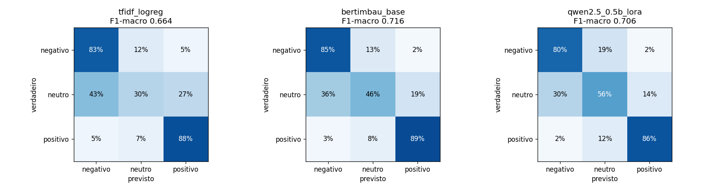

<h1 align="center">Classificação de avaliações de clientes (análise de sentimento)</h1>

<p align="center">
  Modelo clássico, <b>fine-tuning</b> (BERTimbau e Qwen2.5 + LoRA) e <b>LLM zero-shot</b> comparados
  no mesmo conjunto de teste — em <b>qualidade, latência e custo</b>.
</p>

<p align="center">
  <a href="https://github.com/rafantavares/avaliacoes-ptbr-llm/actions/workflows/testes.yml"></a>
  
  
  
</p>

---

## A pergunta

Para classificar milhares de avaliações de clientes por dia, vale mais **chamar um LLM grande por
requisição** ou **ajustar um modelo pequeno e rodá-lo na própria infraestrutura**? A resposta depende
de qualidade, mas também de latência e custo — então este projeto mede os três.

**Dados:** 40.977 avaliações reais com comentário (35.056 após remover duplicatas) da [Olist](https://www.kaggle.com/datasets/olistbr/brazilian-ecommerce)
com comentário. A nota vira o rótulo: 1–2 estrelas = **negativo**, 3 = **neutro**, 4–5 = **positivo**.

## Resultados

Conjunto de teste: **5.259 avaliações** (15%, estratificado). Métrica principal: **F1-macro**, porque as
classes são desbalanceadas (62% positivas, 9% neutras) e a acurácia esconderia um modelo que ignora o neutro.

| Abordagem | F1-macro | Acurácia | F1 neutro | Parâmetros treinados | Treino | Inferência\* |
|---|---|---|---|---|---|---|
| TF-IDF + regressão logística | 0,662 | 81,4% | 0,271 | — | 16 s (CPU) | 0,16 ms (CPU) |
| **BERTimbau base** (ajuste completo) | **0,716** | **84,1%** | 0,378 | 109 mi (100%) | 6,6 min (T4) | 2,9 ms (T4) |
| Qwen2.5-0.5B-Instruct + LoRA | 0,706 | 81,5% | **0,384** | 2,2 mi (0,4%) | 24,7 min (T4) | 11,5 ms (T4) |
| Gemini 3.5 Flash-Lite zero-shot\*\* | 0,686 | 84,4% | 0,273 | — | nenhum | 1,3 s (API, mediana) |

\* Tempo médio por avaliação, processando o conjunto de teste em lote.
\*\* Pelo limite diário do nível gratuito, o LLM foi avaliado numa amostra estratificada de **501 avaliações** do
mesmo conjunto de teste (46 neutras). Na mesma amostra, o TF-IDF faz 0,646 de F1-macro. Com amostra pequena,
diferenças de poucos centésimos estão dentro da margem de erro. Custo: zero no nível gratuito, ~173 tokens de
entrada e ~12 de saída por avaliação; latência p95 de 23 s por causa das esperas no limite de requisições.



**O que os números dizem:**

- **Fine-tuning compensa:** os dois modelos ajustados ganham ~5 pontos de F1-macro sobre o baseline e
  levam o F1 do **neutro** de 0,27 para ~0,38 — é ali que o modelo clássico falhava.
- **BERTimbau vence no geral e é 4× mais rápido que o Qwen.** Um encoder de 110 milhões de parâmetros,
  pré-treinado em português, ainda é a melhor escolha para classificação em português.
- **O Qwen com LoRA chega perto treinando só 0,4% dos parâmetros** e é o melhor no neutro. O adaptador
  publicado tem ~9 MB, contra ~440 MB do BERTimbau inteiro.
- **O LLM sem treino nenhum supera o baseline clássico** (0,686 contra 0,646 na mesma amostra), mas fica
  atrás dos modelos ajustados e, no neutro (0,27), fica no nível do TF-IDF: ele acerta o tom geral, não a fronteira de
  "3 estrelas" que os modelos ajustados aprendem com os dados. E custa uma chamada de rede por avaliação,
  contra milissegundos de um modelo local.
- **O neutro continua difícil para todos (F1 < 0,4), nos dois sentidos:** das 480 avaliações neutras, o
  BERTimbau classifica 171 como negativas (quem dá 3 estrelas costuma reclamar de algo); e 270 positivas
  viram neutras. O rótulo vem da nota, não do texto, então parte desse erro é ruído do próprio rótulo.

**Execução no Kaggle:** [notebook com os logs de treino](https://www.kaggle.com/code/rafaelnunestavares/notebook376b525d99) ·
**Modelos publicados no Hugging Face:**
[rafantavares/bertimbau-sentimento-avaliacoes-ptbr](https://huggingface.co/rafantavares/bertimbau-sentimento-avaliacoes-ptbr) ·
[rafantavares/qwen2.5-0.5b-lora-sentimento-avaliacoes-ptbr](https://huggingface.co/rafantavares/qwen2.5-0.5b-lora-sentimento-avaliacoes-ptbr)

## Decisões de engenharia

| Decisão | Por quê |
|---|---|
| **Remover duplicatas antes de dividir** | "Ótimo produto" aparece centenas de vezes. Com a mesma frase no treino e no teste, as métricas ficariam infladas (vazamento). A comparação é feita por uma forma normalizada do texto (sem acento, caixa e pontuação). |
| **Mesma partição para todas as abordagens** | A divisão tem semente fixa e uma impressão digital (hash) do teste. O notebook do Kaggle confere o hash antes de treinar, garantindo que todos os modelos foram avaliados nas mesmas avaliações. |
| **Perda ponderada por classe** | Sem isso, os modelos aprendem a quase nunca prever "neutro". |
| **LoRA no Qwen** | Treina ~1% dos parâmetros: cabe numa GPU gratuita e o resultado é um adaptador de poucos MB. |
| **Saída estruturada no LLM** | O LLM responde num esquema JSON com enum fechado; resposta fora do esquema conta como erro, não é "consertada" depois. |
| **LLM com versão fixa e retentativas** | No limite do nível gratuito (429) ou em sobrecarga (5xx), espera de forma progressiva e tenta de novo. Não troca de modelo no meio: misturar respostas de dois modelos invalidaria a comparação. Cada resposta vai para um cache, então a execução pode parar no limite diário e continuar no dia seguinte. |

## Estrutura

```
src/avaliacoes/
  dados.py           # limpeza, deduplicação, rótulos, divisão estratificada + hash do teste
  baseline.py        # TF-IDF (palavras + n-gramas de caracteres) + regressão logística
  finetune.py        # BERTimbau e Qwen2.5 + LoRA com o mesmo laço de treino
  llm_zero_shot.py   # Gemini (gratuito) ou Claude, com latência e tokens medidos
  metricas.py        # F1-macro, F1 por classe e matriz de confusão — iguais para todos
notebooks/
  finetune_kaggle.ipynb   # treino na GPU gratuita do Kaggle
results/             # métricas de cada abordagem em JSON
tests/               # 22 testes (dados, métricas, LLM com provedor simulado)
```

## Como reproduzir

```bash
pip install -e ".[dev]"
# baixe olist_order_reviews_dataset.csv para data/raw/ (Kaggle: olistbr/brazilian-ecommerce)
python -m avaliacoes.dados        # gera data/processed/{treino,validacao,teste}.csv
python -m avaliacoes.baseline     # baseline em segundos, na CPU

pip install -e ".[llm]"
echo GEMINI_API_KEY=... > .env    # chave gratuita do Google AI Studio
python -m avaliacoes.llm_zero_shot -n 500
```

O fine-tuning roda no [notebook do Kaggle](notebooks/finetune_kaggle.ipynb) (GPU gratuita) — a execução
que gerou os resultados acima está pública no Kaggle: [Análise de sentimento PT-BR: BERTimbau vs Qwen2.5 LoRA](https://www.kaggle.com/code/rafaelnunestavares/notebook376b525d99).

## Limitações

- O rótulo vem da **nota**, não de anotação humana do texto: há avaliações com texto positivo e nota baixa
  (o problema foi na entrega, não no produto). Parte do erro "inevitável" está aí.
- O LLM zero-shot é avaliado numa amostra estratificada de 500 avaliações do teste, não no teste inteiro,
  para caber no limite do nível gratuito.
- Dados sob licença **CC BY-NC-SA 4.0** (Olist): uso não comercial.

## Autor

**Rafael Nunes Tavares** — [github.com/rafantavares](https://github.com/rafantavares) ·
[LinkedIn](https://www.linkedin.com/in/rafael-nunes-tavares-20a76628b)

Desenvolvido com apoio do [Claude Code](https://claude.com/claude-code); desenho do experimento,
decisões e análise dos resultados feitos por mim.
